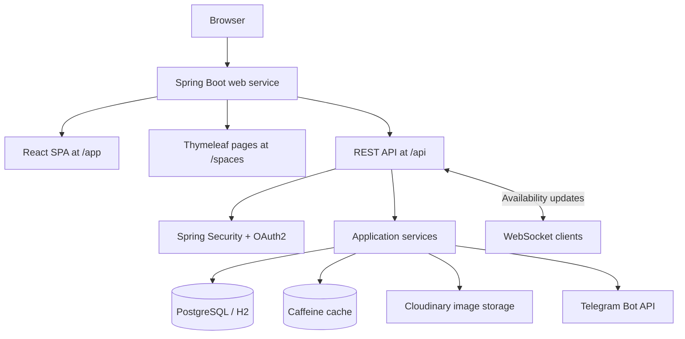

<div align="center">

# SpotPulse

### Find your space. Make room for what matters.

**A full-stack coworking discovery and meeting-room booking platform.**

Explore spaces, check room availability, manage reservations, and run coworking operations from a responsive web application.

[**Live application**](https://spotpulse.onrender.com/app/spaces) · [**GitHub repository**](https://github.com/oleksandratupchiy/spotpulse)


</div>

---

## Overview

**SpotPulse** brings coworking discovery, room booking, and space management together in one application. It combines a React single-page interface with a Spring Boot REST API, while server-rendered Thymeleaf pages provide a separate, search-engine-friendly view of coworking spaces.

The project includes secure Google sign-in, role-based access control, live room-availability updates, optional Telegram notifications, cloud image storage, analytics, and automated quality checks.

### Explore the app

| Experience | Link |
| --- | --- |
| **React application** | [Open SpotPulse](https://spotpulse.onrender.com/app/spaces) |
| **Server-rendered coworking catalog** | [Browse spaces](https://spotpulse.onrender.com/spaces) |
| **Health endpoint** | [Check service health](https://spotpulse.onrender.com/health) |

> The application is deployed on Render. The first request may take longer if the service needs to start.

## Features

| Area | Capabilities |
| --- | --- |
| **Discovery** | Coworking catalog, search, city filters, autocomplete, pagination, and interactive OpenStreetMap/Leaflet maps |
| **Booking** | Room details, availability checks, booking creation, cancellation, and conflict validation |
| **Live updates** | Compare WebSocket notifications with configurable HTTP polling for room availability |
| **Identity & access** | Google OAuth2 / OpenID Connect, server-side sessions, CSRF protection, and `USER`, `OWNER`, `ADMIN` permissions |
| **Management** | Manage owned spaces, rooms, images, and authorized administrative operations |
| **Images** | Browser File API preview, server-side validation, and configurable local or Cloudinary storage |
| **Notifications** | Optional Telegram account linking and booking-related notifications |
| **Premium features** | Administrator-controlled feature flags, featured spaces, badges, and advanced analytics |
| **Insights** | Booking analytics visualized with Chart.js; optional consent-based Google Analytics 4 integration |
| **Performance** | Caffeine caching with cache invalidation after committed data changes |
| **SEO** | Thymeleaf-rendered pages, metadata, structured data, sitemap, and robots.txt |

## Technology stack

<table>
<tr><td><strong>Frontend</strong></td><td>React 19 · TypeScript · Vite · React Router · Bootstrap · Chart.js · Leaflet · jQuery</td></tr>
<tr><td><strong>Backend</strong></td><td>Java 25 · Spring Boot 4 · Spring MVC · Spring Data JPA · Spring Security · WebSocket</td></tr>
<tr><td><strong>Data</strong></td><td>PostgreSQL (deployment / Docker Compose) · H2 (local development and isolated tests) · Caffeine</td></tr>
<tr><td><strong>Integrations</strong></td><td>Google OAuth2 · Telegram Bot API · Cloudinary · Google Analytics 4 · OpenStreetMap</td></tr>
<tr><td><strong>DevOps</strong></td><td>Docker · Docker Compose · GitHub Actions · Render</td></tr>
<tr><td><strong>Testing</strong></td><td>JUnit · Vitest · Playwright · Postman collections · Newman</td></tr>
</table>

## Architecture



The production deployment packages the React frontend and Spring Boot backend into **one Dockerized web service**, backed by PostgreSQL. The frontend uses same-origin API requests; the backend also serves dedicated Thymeleaf pages for SEO.

## Project structure

```text
spotpulse/
├── spotpulse-backend/       # Spring Boot API, domain logic, security, tests
│   ├── src/
│   ├── docs/                # Feature-specific implementation notes
│   └── tools/               # Test and geocoding utilities
├── spotpulse-frontend/      # React / TypeScript application
│   ├── src/
│   └── e2e/                 # Playwright browser tests
├── tools/postman/           # Newman runner and safety checks
├── postman_collection.json # API test collection
├── .github/workflows/      # Continuous integration
├── docker-compose.yml      # Local backend + PostgreSQL
└── Dockerfile              # Multi-stage production build
```

## Getting started

### Prerequisites

- **Java 25**
- **Node.js 24** and npm
- **Python 3.12+** for selected test utilities
- **Docker** (optional, for the container workflow)

### 1. Clone the repository

```bash
git clone https://github.com/oleksandratupchiy/spotpulse.git
cd spotpulse
```

### 2. Start the backend

The local development configuration supports H2. From `spotpulse-backend`:

**Windows (PowerShell)**

```powershell
cd spotpulse-backend
.\mvnw.cmd spring-boot:run
```

**macOS / Linux**

```bash
cd spotpulse-backend
./mvnw spring-boot:run
```

By default, the backend is available at **http://localhost:8080**.

> Google sign-in and third-party services require their respective environment configuration. Do not commit credentials or place backend secrets in `VITE_*` variables.

### 3. Start the frontend

In a **second terminal**, from the repository root:

```bash
cd spotpulse-frontend
npm ci
npm run dev
```

Open **http://localhost:5173/spaces**. Vite proxies API and WebSocket requests to the local backend.

### Alternative: Docker Compose

From the repository root:

```bash
docker compose up --build
```

This starts a backend container and a PostgreSQL 16 container for the local Compose workflow. The API is exposed at **http://localhost:8080**.

> The Compose setup uses `spotpulse-backend/Dockerfile` and is distinct from the repository-root multi-stage production `Dockerfile` that bundles React with Spring Boot. The database credentials in `docker-compose.yml` are for local development only.

## Testing

The repository includes backend, frontend, API, and browser-level tests.

**Backend — from `spotpulse-backend`:**

```powershell
.\mvnw.cmd test
```

**Frontend unit tests — from `spotpulse-frontend`:**

```bash
npm ci
npm test
```

**Playwright E2E — from `spotpulse-frontend`:**

```bash
npx playwright install chromium
npm run e2e:typecheck
npm run e2e:prepare
npm run e2e
npm run e2e:report
```

**Postman / Newman — from the repository root:**

```bash
npm --prefix tools/postman ci --include=dev --ignore-scripts --no-audit --no-fund
npm --prefix tools/postman run test:safety
npm --prefix tools/postman run prepare:backend
npm --prefix tools/postman test
```

> Playwright and Newman use **isolated local test backends and disposable data**. Never repoint their test runners at the production deployment or a personal persistent database. Run backend preparation and automated test suites sequentially when they share build outputs.

### Continuous integration

GitHub Actions runs backend checks, React tests and build, utility checks, Playwright E2E, Postman/Newman API verification, and the production Docker image build.

[**View CI workflows**](https://github.com/oleksandratupchiy/spotpulse/actions)

## Security and deployment notes

- Authentication uses **Google OpenID Connect** with backend-managed sessions.
- Authorization is enforced server-side; ownership checks restrict access to managed resources.
- Mutating requests use **CSRF protection**.
- Secrets belong in backend environment variables or deployment secret settings, **not** source files or client bundles.
- Production uses PostgreSQL and a non-root Docker runtime; local development can use H2.
- Optional external integrations require configuration and may be unavailable in a standalone local run.

## Documentation

Detailed implementation notes are available in [`spotpulse-backend/docs`](https://github.com/oleksandratupchiy/spotpulse/tree/main/spotpulse-backend/docs), covering deployment, authentication, maps, caching, notifications, analytics, and test infrastructure.

---

<div align="center">

**SpotPulse** · Built with Spring Boot and React

[Live demo](https://spotpulse.onrender.com/app/spaces) · [Source code](https://github.com/oleksandratupchiy/spotpulse)

</div>
