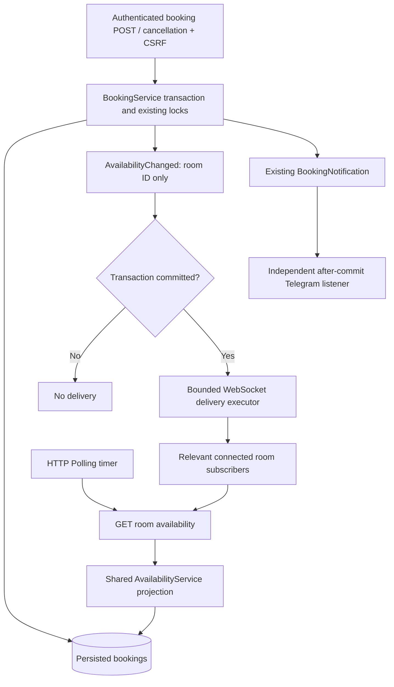

# C10 — WebSockets versus HTTP polling

## Scenario and shared availability model

A visitor watches one meeting room over a selected interval while another signed-in user creates or cancels a booking. Both transports refresh the same authoritative public endpoint:

```http
GET /api/rooms/{id}/availability?from=2026-12-01T10:00&to=2026-12-01T18:00
```

Example response shape (illustrative schema, not benchmark data):

```json
{"roomId":3,"from":"2026-12-01T10:00:00","to":"2026-12-01T18:00:00","occupied":[{"start":"2026-12-01T12:00:00","end":"2026-12-01T13:00:00"}]}
```

`AvailabilityService` queries only persisted CONFIRMED bookings. Its repository projection contains start/end timestamps; customer identities, booking IDs, emails and contact details never enter the public DTO. Cancelled bookings are excluded. The query uses the existing overlap rule `booking.start < requested.to AND booking.end > requested.from`: intervals touching at a boundary do not overlap. Returned occupancy is clipped to the requested interval. Gaps in the occupied list are available at read time, with no reservation guarantee.

Times use the existing `LocalDateTime` stored-calendar convention, without conversion to UTC. Requests must have increasing endpoints and span at most 31 days. Room IDs must be positive and exist. The database reads at most 501 projected rows; a result above 500 is rejected with a request to shorten the interval rather than silently reporting incomplete availability. Invalid input returns 400; unknown rooms return 404. Booking creation, validation, locks, conflict handling and cancellation remain in `BookingService`.

Availability responses carry `Cache-Control: no-store`, and React explicitly requests `cache: 'no-store'`. These reads bypass Caffeine. Existing B9 after-commit cache invalidation remains in place for the existing endpoints. A push notification cannot lead a client to an old availability cache entry. If a change arrives during a pending React request, that response is discarded and one coalesced follow-up reads the new state.

## Architecture and event flow



`AvailabilityChanged` is published within the same booking transaction and consumed by a Spring `@TransactionalEventListener` using its default AFTER_COMMIT phase. No fallback delivery outside transactions is enabled. This follows Spring's documented [transaction-bound event behavior](https://docs.spring.io/spring-framework/reference/data-access/transaction/event.html).

The existing Telegram event has no room ID and covers recipient/status notifications rather than all occupancy changes. It is preserved unchanged; C10 adds a minimal room event at the existing lifecycle boundaries. Confirmed creation, effective cancellation, administrator time/room/status updates and deletion of confirmed bookings invalidate affected rooms. Moving a confirmed booking invalidates both rooms. Repeated cancellation sends no duplicate event. Existing `ReadDataChanged` publications remain intact. Network delivery uses its own bounded executor; Telegram failures or a slow WebSocket client cannot reverse a committed booking or prevent other transport deliveries.

## WebSocket implementation

Native Spring servlet WebSockets are registered through `@EnableWebSocket` and `WebSocketConfigurer`, without SockJS, STOMP or a broker. The single read-only endpoint is:

```text
ws://localhost:5173/api/rooms/availability/ws?roomId=3
```

The HTTP handshake passes through the existing Spring Security filter chain. The existing public GET rule for `/api/rooms/**` permits this deliberately public channel. The handshake interceptor independently requires an exact trusted Origin, one valid `roomId` query parameter and an existing room. Origins are configured separately from OAuth2:

```properties
spotpulse.availability.allowed-origins=${SPOTPULSE_AVAILABILITY_ALLOWED_ORIGINS:http://localhost:5173,http://localhost:8080}
```

Production must set the exact deployed frontend origin, for example `SPOTPULSE_AVAILABILITY_ALLOWED_ORIGINS=https://spotpulse.example`. Paths, wildcard origins, userinfo, query strings and fragments are rejected. Missing Origin is also denied. Vite proxies `/api` with `ws: true`; deployed proxies must forward WebSocket Upgrade and preserve the browser Origin. URL construction honors the existing API base and selects `wss:` when that base uses HTTPS.

After connection, the server sends a `ready` message. After a committed change, it sends only:

```json
{"type":"availability.changed","roomId":3,"signal":"a-fresh-UUID"}
```

The UUID is an opaque invalidation signal, not an ordered revision or a replay cursor. Clients do not apply event deltas or infer ordering; every valid signal requests an authoritative snapshot. Reconnect always refreshes, covering the subscription gap and missed changes. A visible WebSocket panel also reconciles every 60 seconds, repairing an occasional dropped signal without replay storage.

The server rejects all inbound text/binary application messages with policy-close 1008. There are no commands, subscriptions to private topics, booking DTOs or mutation handlers. Resource bounds are 100 active connections, 20 per observed peer address, 128-byte inbound payloads, a 4096-byte concurrent-send buffer, 2-second send limits, two delivery threads and a queue of 128 tasks. Queue rejection does not fail the booking; reconciliation repairs dropped invalidations. Ping frames every 30 seconds detect failed connections, with a 120-second native session idle limit. Disconnection, transport errors and send failures remove clients. Slow sends are isolated and bounded, using Spring's `ConcurrentWebSocketSessionDecorator` plus native servlet/Tomcat send limits. See Spring's [handler, handshake, origin and concurrent-send guidance](https://docs.spring.io/spring-framework/reference/web/websocket/server.html).

React reconnects with delays of 1, 2, 4, 8, 16 and 30 seconds, with a 10-second connection watchdog. Six automatic attempts are allowed per watching lifecycle; success does not reset the budget indefinitely. **Refresh / reconnect** explicitly starts a new lifecycle. Hidden tabs close their socket and refresh/reconnect when shown again. No automatic switch to polling hides a WebSocket failure: both choices remain independently demonstrable.

## HTTP polling implementation and protocol tradeoffs

Polling schedules the next GET after the previous request settles, with selectable 3-, 5- or 10-second waits. The transport helper bounds caller-supplied intervals to 1–30 seconds. It never overlaps its requests. AbortController cancels requests on unmount, range/mode change or hiding the document. Requests time out after 15 seconds; transient errors remain visible and the next scheduled read can recover. Hidden tabs stop timers and immediately refresh when visible. One lifecycle owns and cleans up every timer, request, socket and event listener.

WebSockets begin with an HTTP Upgrade handshake and then keep a channel open for subsequent messages. Polling sends a separate HTTP request for each check, including checks during unchanged periods. HTTP keep-alive can reuse the underlying TCP connection; polling does **not** necessarily reconnect TCP on every request. C10 uses WebSocket for server notifications and ordinary HTTP for snapshots, so it still makes an HTTP read after each change. Spring describes the [persistent-channel and request/response distinction](https://docs.spring.io/spring-framework/reference/web/websocket.html).

| Property | WebSocket mode | HTTP polling mode |
| --- | --- | --- |
| Change detection | Committed event signals a relevant room | Next completed periodic read sees persisted state |
| Idle application traffic | No change messages; periodic reconciliation | Reads continue at selected interval |
| Other idle traffic | Persistent socket and ping/pong frames | HTTP headers and possible connection keep-alive |
| Recovery | Bounded reconnect, then fresh REST read | Retry next read; resume immediately after hidden state |
| Infrastructure | WebSocket-capable proxy; bounded connection state | Ordinary HTTP infrastructure |
| Missed changes | Reconnect and periodic reconciliation | Next successful snapshot |
| Booking authority | Existing protected HTTP booking service | Same service |

## React demonstration panel

`AvailabilityPanel` sits below the existing room details/booking form. Choose **HTTP Polling** or **WebSocket**, select an independent availability interval, and press **Watch availability**. No background traffic starts until a range is selected. The panel shows occupied intervals (or no overlap), mode/connection status, errors, the last successful update, HTTP request count and received WebSocket application-message count. Counts reset when a new lifecycle starts. The HTTP counter records started fetch attempts, including failed/cancelled attempts; it is not a wire-level counter. The WebSocket count includes `ready`, but excludes transport ping/pong and handshake traffic.

`performance.now()` measures the most recent HTTP request duration and, when applicable, notification-handler-to-refreshed-state duration. `Date` is used only to label the last successful update. The UI does not subtract client/server wall timestamps or label request duration as commit latency. Rendering/paint and server commit timing cannot be inferred from those UI counters.

## Reproducible experiment

Run from `spotpulse-backend`:

```powershell
.\mvnw.cmd -B '-Dtest=C10ComparisonExperiment' '-Dc10.trials=10' '-Dc10.clients=1,5' '-Dc10.pollMs=3000' test
```

The explicit experiment class intentionally does not match ordinary Surefire test names. Normal full tests execute functional C10 tests without silently skipping a benchmark test. Bounds are 5–30 changes per cohort, 1–10 clients and a 1–10 second polling interval. The default compares 1 and 5 simultaneous clients, ten alternating booking creations/cancellations per transport, and a 3000 ms poll interval. There are no Google, Telegram or Cloudinary credentials, external services, developer database reads, or developer image writes. A real embedded Tomcat server and native JDK HTTP/WebSocket clients use an isolated in-memory H2 fixture. Trusted synthetic identity is injected only into the test-side booking service calls; no production authentication bypass or benchmark endpoint exists.

All cohorts use the same booking service, room, query range and ten changes. A fixed random seed (`1024`) generates identical mutation gaps within the polling interval. Polling clients have staggered initial phases and use fixed delays after response completion. A shared warm-up GET and create/cancel precede measurements. Cohorts run sequentially, WebSocket then polling for each client count. Frontend verification finished before the measured cohorts; full backend regressions started after the experiment. Other machine load was not controlled.

The test-side highest-priority AFTER_COMMIT listener captures `System.nanoTime()`. Network clients live in the same JVM and use that same monotonic clock. Start means **entry to the first after-commit callback**, just after the database commit; it is not instrumentation of the exact physical database commit instruction. The experiment separately records:

- Callback → complete WebSocket text receipt in the JDK listener (notification latency).
- Callback → authoritative REST response completion with the expected changed occupancy (refresh latency, for both modes).
- WebSocket connect call → received `ready` (handshake-to-ready overhead, separate from steady delivery).
- A 6100 ms idle period with no booking changes, including request/message counts.
- A separate one-client recovery probe: miss a committed change, stay disconnected for 1000 ms, then reconnect/resume and obtain a fresh snapshot. Recovery duration includes that deliberate outage; it is not a benchmark of React's exponential backoff.

Each observation must match the expected occupancy; rollback/conflict and Origin behavior have separate integration tests. Ambiguous negative-clock samples or failed/missing clients fail the experiment rather than entering invented results. Median and p95 use the nearest-rank method. With ten observations, p95 is the maximum; the five-client cohort has 50 observations but only ten distinct changes, so clients are correlated rather than 50 independent experiments.

Outputs are ignored artifacts in `target/c10-benchmark/<timestamp>/`:

- `trials.csv`: each trial/client's actual notification and authoritative-refresh durations.
- `summary.csv`: metrics, counts, payload sizes, handshake, idle and recovery values.
- `summary.md`: generated comparison table.
- `environment.properties`: actual environment and experiment parameters.

Received byte counts sum UTF-8 HTTP response bodies and WebSocket application-text payloads. They **exclude** HTTP headers, WebSocket framing, handshake headers, ping/pong, TCP/TLS overhead, outbound requests and retransmissions. These are application payload totals, not packet captures or full network cost. Steady totals include initialization and idle, and exclude the separate recovery probe. HTTP connection reuse is left to the native JDK client. The harness initializes each client with one snapshot, after WebSocket ready where applicable. React can make an additional startup read because it shows an initial snapshot while connecting and resynchronizes on open; benchmark counts must not be presented as exact browser-session counts. The measured REST endpoint is the point after the response body, status check and payload-counter bookkeeping complete, before occupancy matching. The harness observes a notification/refetch pipeline, not browser DOM rendering, internet performance, or a distributed deployment.

## Actual measurements — 2026-10-30

Successful run: `target/c10-benchmark/20261030-163152/`, experiment 1/1 passed, no failures/errors/skips, Maven **4:27 minutes**. Environment: Windows 11 (`10.0`), amd64, Java 25, four reported logical processors, `Intel64 Family 6 Model 156 Stepping 0, GenuineIntel`, physical memory **16,976,109,568 bytes**. Loopback HTTP/1.1, one embedded Tomcat, isolated H2, no TLS. Interval 3000 ms, ten committed changes per cohort. All table values below come from the saved CSV; milliseconds are rounded to two decimals.

| Mode | Clients | Samples | Median refreshed state ms | p95 refreshed state ms | Median notification ms | p95 notification ms | HTTP GETs | WS text messages | Received payload bytes |
| --- | ---: | ---: | ---: | ---: | ---: | ---: | ---: | ---: | ---: |
| WebSocket | 1 | 10 | 24.07 | 48.33 | 1.85 | 3.68 | 11 | 11 | 2172 |
| Polling | 1 | 10 | 912.54 | 2776.60 | n/a | n/a | 13 | 0 | 1361 |
| WebSocket | 5 | 50 | 82.16 | 111.41 | 9.07 | 25.98 | 55 | 55 | 10860 |
| Polling | 5 | 50 | 1429.45 | 2764.50 | n/a | n/a | 88 | 0 | 9399 |

| Mode | Clients | Handshakes | Median handshake → ready ms | Idle GETs / WS text messages in 6100 ms | Recovery including 1000 ms outage |
| --- | ---: | ---: | ---: | --- | ---: |
| WebSocket | 1 | 1 | 229.30 | 0 / 0 | 1044.24 ms |
| Polling | 1 | 0 | n/a | 2 / 0 | 1043.10 ms |
| WebSocket | 5 | 5 | 10.71 | 0 / 0 | 1053.65 ms |
| Polling | 5 | 0 | n/a | 10 / 0 | 1026.75 ms |

The measured WebSocket pipeline observed changes sooner under this workload. Polling latency depended on its phase relative to each commit, approaching the configured interval at the tail. Five concurrent refetches increased measured WebSocket refresh time, and the result must not be presented as a general server scalability benchmark.

WebSocket made fewer HTTP GETs and no idle application reads in the short idle probe, but its **combined received application payload was larger** in both cohorts: this design sends a notification and then reads a small snapshot, while polling reads only snapshots. The experiment therefore does not support a blanket claim that WebSockets always transfer fewer bytes. The handshake count adds one HTTP upgrade per WebSocket client; do not hide that cost among steady-state text messages. The first handshake was colder than later handshakes, so their difference does not establish an effect of client count. The idle probe was shorter than the 30-second heartbeat and 60-second reconciliation periods; longer idle sessions do incur those costs. Recovery was dominated by the chosen one-second outage, so those values do not establish a meaningful transport winner.

Uncertainty includes OS scheduling, JIT warm-up, loopback client/server CPU sharing, fixed cohort order, timer phases, small sample size, callback timing slightly after the database commit, and unmeasured headers/framing. There are no confidence intervals or browser-render timing claims. Repeat on the intended deployment and alternate cohort order before making capacity or production latency promises.

## Security and cache verification

The new endpoints are read-only and public by design. Origin checking is a browser protection, not authentication: non-browser clients can forge Origin, so every exposed field must remain public-safe. Native inbound messages are rejected, and there is no STOMP SEND surface. Existing HTTP booking mutations retain OAuth2 session identity, roles, ownership restrictions, CSRF and room-lock concurrency protection. Availability checks never grant authorization to create a booking. Premium/analytics data is not queried or included.

Resource limits bound active sessions, per-peer sessions, payloads, send buffers, worker threads, delivery queue and retry attempts. A reverse proxy may make many clients share a peer address and therefore the 20-connection quota; trusted proxy handling would need deliberate deployment configuration rather than trusting arbitrary forwarded headers. Server-side connection state is process-local; multi-instance production needs a shared event backplane. Failures or dropped invalidations are repaired by authoritative rereads, not treated as reservation guarantees.

## Two-tab browser demonstration

1. Start the usual backend and Vite frontend. Open the same room detail URL in two tabs.
2. In each tab, enter the same future availability interval and click Watch availability. Select WebSocket in tab A and HTTP Polling at 3 seconds in tab B.
3. Keep the compared tabs visible, for example in two browser windows side by side. Hidden tabs intentionally pause; two background tabs are not equivalent measurement conditions.
4. Create a confirmed booking in the existing authenticated form. Watch A receive a small notification and refresh; B updates on its next poll. Show the mode, last success, counts and client durations. The booking confirmation itself is unchanged.
5. Cancel from My bookings (or permitted management view). Show the occupied interval disappear in both panels. An overlapping create still receives the existing conflict response.
6. In Network tools, compare HTTP GETs with WebSocket text frames. Confirm frames contain only room ID, type and signal, while snapshot bodies contain only occupancy. Do not present UI request duration as committed-change latency.
7. Hide a tab, create/cancel in the other, then show it. It must immediately reread current state; the WebSocket reconnects and does not depend on replaying missed events.
8. Block the WebSocket route or disconnect the network. Show bounded reconnect status and errors, then restore it and use Refresh / reconnect if the attempt budget was exhausted. Switch modes and navigate away; old sockets, requests and timers must stop.
9. Attempt an untrusted/missing Origin handshake (automated integration tests do this precisely), and try a client command: the handshake is denied or the socket closes without mutating any booking. Existing protected HTTP writes still require authentication and CSRF.

Interactive browser verification was not performed in this coding session. Real network verification uses the embedded server with JDK clients; React behavior is covered by jsdom tests.

## Verification commands and results

```powershell
# backend
.\mvnw.cmd -B test
.\mvnw.cmd -B '-Dtest=AvailabilityIntegrationTests,AvailabilityLimitsTests' test
# frontend
npm.cmd test
npm.cmd run build
```

- Initial dedicated network C10 run: **6/6 passed**, no failures/errors/skips. It was then expanded with administrator move/delete and failed-delivery tests, plus limit tests.
- Final full React suite: **91/91 passed in 9 files**, **84.45 seconds**, including all **9 C10 tests** and existing booking/Auth, Premium, maps, Telegram, images and API tests.
- Final TypeScript check and production build: **passed** (`tsc --noEmit && vite build`), 63 modules, Vite **20.16 seconds**.
- Benchmark: **1/1 passed**, actual values above. It is explicitly invoked and not part of ordinary test timing.
- Full backend suite (`mvnw.cmd -B test`): **180/180 passed**, **0 failures, 0 errors, 0 skipped**, Maven **4:54 minutes**. Includes all 170 prior tests plus 8 C10 integration and 2 C10 limits tests, preserving booking concurrency, OAuth2/security, B9 caches, Premium, Telegram, maps and image uploads.
- Final dedicated C10 run (`mvnw.cmd -B '-Dtest=AvailabilityIntegrationTests,AvailabilityLimitsTests' test`): **10/10 passed**, **0 failures, 0 errors, 0 skipped**, Maven **58.634 seconds**. Covers real WebSocket delivery and multiple subscribers, Origin and inbound mutation denial, overlap/clipping, public-data safety, fresh snapshots and cancellation, rollback/conflict suppression, administrator moves/deletion, failed delivery isolation, response bounds, per-peer connection bounds, payload limits and disconnect cleanup.

Raw backend logs are in ignored `target/c10-*.log` files; frontend logs are retained in ignored `target/c10-verification/`. The C10 tracked-file whitespace check passed. Concurrent edits outside the C10 inventory were left untouched.

The existing test-only database guard and temporary image-directory isolation remain active. The experiment uses only in-memory H2. The restart regression uses its own verified temporary file-based H2 directory; no developer persistent data is reset.

## Limitations and recommendation

For active booking views where changes should appear promptly, WebSocket notifications plus authoritative snapshots are preferable based on this local latency evidence, provided hosting supports long-lived connections and an event backplane is added for multiple application instances. For a small installation, infrequently visited views, restrictive proxies or tolerance of a few seconds' staleness, polling is simpler and remains a useful independently selectable fallback. Neither method replaces transaction-time availability checks.

There is no durable replay stream, distributed broadcaster, ETag optimization, booking mutation over WebSocket, application-level cross-origin authentication bypass or packet-level byte accounting. Queue overflow can drop a notification; a visible WebSocket panel reconciles within its next successful 60-second refresh, while reconnect/visibility resume reads immediately. Persistent delivery failures can keep data stale and are displayed. The measured recovery probe does not simulate every reconnect backoff failure or real browser rendering. Live PostgreSQL, remote network behavior, mobile battery consumption and interactive Google/browser sessions remain unmeasured.

## C10 source inventory

- Backend: `pom.xml`; `availability/AvailabilityService.java`, `AvailabilityController.java`, `AvailabilityChanged.java`, `AvailabilitySocket.java`, `AvailabilityWebSocketConfiguration.java`; `repository/BookingRepository.java`; `service/BookingService.java`; `application.properties`.
- Backend tests/harness: `availability/AvailabilityTestSupport.java`, `AvailabilityIntegrationTests.java`, `AvailabilityLimitsTests.java`, `C10ComparisonExperiment.java`.
- Frontend: `AvailabilityPanel.tsx`, `availability.ts`, `App.tsx`, `test/Availability.test.tsx`, `vite.config.ts`.
- Documentation: this file. README and generated `bin/` files are not modified; no commit or push is performed.
