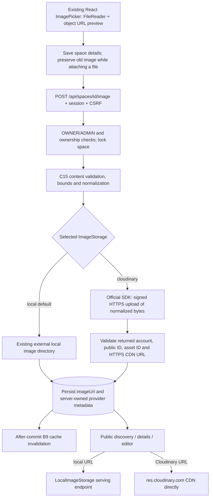

# C19 — Cloudinary storage and CDN delivery

## What is implemented

C19 adds an optional Cloudinary adapter behind the C15 `ImageStorage` boundary. Local development still defaults to local storage and needs **no Cloudinary account or credentials**. The existing authenticated multipart upload API, Browser File API picker, image preview and public `imageUrl` contract are retained. Cloudinary is used for real server-side uploads when explicitly selected; test doubles exist only in automated tests.

New uploads select one provider. Reading existing images does not depend on that selection: local keys continue through the local-serving controller, while absolute external and Cloudinary URLs load directly from their existing hosts. Nothing migrates, rewrites or deletes legacy image references.

## Architecture



`ImageStorageConfiguration` selects the primary upload adapter, while `LocalImageStorage` remains available regardless of provider. `SpaceImageController` explicitly reads local files through that local adapter. Cloudinary's `read` operation does not fetch or proxy cloud bytes through Spring Boot.

The adapter uses the official **`com.cloudinary:cloudinary-http5:2.5.0`** Java SDK, compatible with the repository's Java 25 build. The SDK constructs and signs requests; SpotPulse does not implement cryptographic signing. See the [Cloudinary Java SDK guide](https://cloudinary.com/documentation/java_integration) and [Upload API reference](https://cloudinary.com/documentation/image_upload_api_reference).

## Backend-only configuration

| Environment variable | Meaning | Required |
| --- | --- | --- |
| `SPOTPULSE_IMAGE_STORAGE` | Exactly `local` or `cloudinary` | Optional; defaults to `local` |
| `CLOUDINARY_CLOUD_NAME` | Cloudinary product-environment cloud name | Only in `cloudinary` mode |
| `CLOUDINARY_API_KEY` | Backend upload API key | Only in `cloudinary` mode |
| `CLOUDINARY_API_SECRET` | Backend SDK signing secret | Only in `cloudinary` mode |

Set credentials in the **backend process environment**, using the backend IDE run configuration or the deployment's secret mechanism. Do not paste them into documentation, committed files, browser code, a `VITE_*` variable, command output or screenshots. No credentials are present in the frontend bundle. The cloud name naturally becomes part of public delivery URLs; the API key and secret do not.

With those three variables supplied securely to the backend process:

```powershell
# From spotpulse-backend
$env:SPOTPULSE_IMAGE_STORAGE = 'cloudinary'
.\mvnw.cmd spring-boot:run
```

To continue with credential-free local development:

```powershell
$env:SPOTPULSE_IMAGE_STORAGE = 'local'
.\mvnw.cmd spring-boot:run
```

The mapped Spring setting is `spotpulse.images.storage-provider=${SPOTPULSE_IMAGE_STORAGE:local}`. An unknown provider fails startup. Explicit Cloudinary selection validates all three credentials and never silently falls back. Validation rejects missing values, invalid cloud-name characters, a non-numeric API key and whitespace/control characters in the secret. Configuration errors list the required environment-variable **names**, without their values. Syntax is checked at startup; actual account authentication is checked by Cloudinary on the first upload, not through an unsolicited startup network request. Complete-looking but incorrect credentials produce a safe upload failure.

The SDK is configured with `secure=true`, the fixed upload API prefix `https://api.cloudinary.com`, and finite **15-second connection-lease, connect and response timeouts**. These are per-phase HTTP timeouts, not a promise that every complete workflow lasts at most 15 seconds. At most **eight upload receipts** can be in flight/pending transaction completion per adapter. Additional attempts return 503 and can be retried. No application upload retry loop is added.

SDK, Apache HTTP wire and header loggers are disabled in application configuration. Provider exceptions are converted to fixed safe errors without their original causes. Cleanup warnings contain no exception, signature, request body or credential. `CloudinarySettings` has a redacted `toString` and is never returned by an API.

## Upload and persistence lifecycle

1. OWNER/ADMIN selects and previews a file using C15. Filename, size, MIME and dimensions remain visible; no Cloudinary browser SDK or credentials are introduced.
2. Saving uses the existing space create/update API. A new space is owned before its image is attached. When a file is selected, the details save preserves the previously saved image URL, including when the URL text was also edited. That prevents an unsuccessful attachment from replacing the old image prematurely.
3. `POST /api/spaces/{id}/image` obtains the current session/CSRF protection, checks ownership through the existing policy, locks the space and rechecks ownership after locking.
4. Existing `ImageValidation` checks real file content independently of browser metadata. Supported inputs are JPEG, PNG and WebP, at most **8 MiB (8,388,608 bytes)**, **8192 pixels per side** and **12,000,000 pixels**. Empty, corrupt, MIME-mismatched, SVG/HTML and other unsupported files are rejected. Original path-bearing filenames are rejected. Decoder dimensions are checked before full decoding.
5. C15 re-encodes safe still pixels as JPEG or PNG, stripping metadata, appended payloads and extra frames. WebP inputs become PNG. Normalized bytes remain bounded to 8 MiB. Only those bytes reach Cloudinary; filenames, customer/OAuth information, arbitrary remote URLs and browser-selected public IDs do not.
6. `CloudinaryImageStorage` generates `spotpulse/spaces/<UUID>` as the public ID. The SDK sends a signed image/upload request with `overwrite=false`, `use_filename=false`, `unique_filename=false` and a fixed normalized filename. The prefix scopes the public ID under SpotPulse; Cloudinary Media Library folder appearance may differ between its fixed and dynamic folder modes.
7. The adapter validates the returned provider object before accepting it. It requires the generated public ID, an opaque safe asset ID, `resource_type=image`, `type=upload`, matching normalized format, positive integral version, bounded bytes/dimensions and an exact canonical HTTPS delivery URL for the configured account. Existing-asset responses, missing fields, foreign hosts, userinfo, ports, query strings, fragments, path changes and unsafe resource identities are rejected.
8. The existing Space row receives the CDN `imageUrl` and nullable, server-owned metadata: `imageStorageProvider`, `imageStorageKey` and `imageAssetId`. These additive JPA columns preserve old rows, work with H2/PostgreSQL and are not exposed in `SpaceDto` or accepted as writable DTO fields. No database reset or bulk data rewrite occurs.
9. A committed attachment invalidates the existing SPACES read caches using the existing after-commit event. Public cards/details and the editor receive the stable new URL. A failed attachment preserves the old URL and metadata. React retains the selection and saved space ID, displays the failure, and retries against that space instead of creating a duplicate.

Cloudinary API/response failures use safe 502 responses; recognizable upload timeouts use 504, and exhausted local upload capacity uses 503. Existing file validation and multipart limits remain in force. The existing UI reports that the space details were saved but attachment failed; it does not claim an upload succeeded. While attaching, it shows **Uploading selected image…**. No fabricated percentage is shown.

## CDN delivery and URL validation

Accepted new URLs have this structure:

```text
https://res.cloudinary.com/<configured-cloud-name>/image/upload/v<positive-version>/spotpulse/spaces/<generated-UUID>.<jpg-or-png>
```

The returned URL must exactly match the response's validated version, configured account, generated public ID and normalized format. Only the standard `res.cloudinary.com` delivery host is accepted; custom CNAMEs, alternate delivery hosts and transformed response URLs are intentionally unsupported. The URL length remains within the existing 255-character `imageUrl` limit.

Cloudinary images are public `image/upload` assets. React's existing ordinary `` loads them directly, without an image proxy or authenticated browser upload. It does not use `fetch` to retrieve CDN image bytes or set a CORS mode/crossorigin attribute. Existing fixed-size image/placeholder layout and broken-image fallback are preserved. Canvas export or credentialed cross-origin image processing is not part of this feature.

No eager transformations, add-ons, dynamically varying resize parameters or automatic optimization derivatives are requested. The original normalized image is delivered under a versioned URL. This keeps the initial integration predictable; a later bounded set of responsive transformations can be introduced with deliberate cost and cache analysis.

| Aspect | Local delivery | Cloudinary CDN delivery |
| --- | --- | --- |
| Backend authenticated upload | Existing protected multipart endpoint | Same endpoint; backend then calls Cloudinary |
| Storage | External local SpotPulse image directory | Cloudinary account under SpotPulse public-ID prefix |
| Browser image request | `/api/spaces/images/<generated-key>` | Absolute `https://res.cloudinary.com/...` |
| Spring image-byte serving | Yes, controlled local key handler | No; CDN serves directly |
| Credentials needed | None | Backend upload credentials only |
| Multi-instance hosting | Needs shared local storage | Public delivery independent of the application instance |
| Hosting/account dependency | Local filesystem and backend | Cloudinary account, network and plan allowances |

This is an architectural comparison, not an invented image-delivery speed benchmark. A normal browser network check is still needed to prove live CDN behavior for the configured account.

## Compatibility and safe cleanup

Provider selection controls **new uploads only**. Previously persisted local references, unrelated external URLs and Cloudinary URLs remain unchanged. Local serving always uses `LocalImageStorage`; it does not call the selected Cloudinary adapter. Cloudinary URLs continue to load from their stored account even if new uploads are later switched to local or another configured account. The local directory configuration and C15 cleanup semantics remain unchanged.

Manual Image URL editing remains supported. Changing the URL clears the server-owned storage identity; an unchanged URL preserves it. A browser cannot obtain ownership/deletion rights by posting an `imageStorageKey`, provider field or a Cloudinary-looking URL. No unrestricted image-deletion endpoint exists.

Previously committed image objects are **retained** after replacement, manual URL editing or space deletion, matching C15. Another record or public cache may still use them. C19 never deletes an old Cloudinary asset based on the previous URL or currently selected provider.

For an upload followed by database rollback, the adapter keeps an in-memory receipt for the **exact returned Stored object**, with a server-generated ID and validated provider identity. Only that pending receipt authorizes `destroy` in the image/upload namespace. Equivalent forged records, arbitrary URLs, unrelated public IDs, already committed receipts and repeated cleanup calls cannot authorize deletion. A committed or unknown transaction outcome releases the receipt without deleting the asset. Rollback deletion uses the official signed SDK destroy operation with invalidation enabled; failure produces a fixed warning and does not alter the preserved old image or mask the database outcome.

There is no atomic transaction spanning Cloudinary and the database. A timed-out upload may have succeeded remotely, an invalid response may leave an object, process termination may occur before compensation, or destroy may fail. In these ambiguous cases the adapter prioritizes avoiding deletion of unrelated/possibly committed assets. Orphans require an authenticated operator to reconcile the `spotpulse/spaces/` prefix against database references and server-owned metadata before deleting anything. There is no scheduled purge or automatic deletion of retained committed images.

## Security guarantees

- Existing OAuth2, fresh role/identity handling, OWNER ownership and ADMIN permissions apply to upload/replacement; USER and anonymous callers are denied.
- Existing session CSRF applies to mutations. No unsigned browser upload preset, signed upload credential endpoint or Cloudinary secret is exposed.
- File types, sizes and dimensions are validated server-side; only normalized binary data is uploaded. No untrusted remote URL is fetched by the backend or supplied to the SDK.
- Public IDs and cleanup targets are generated/owned by the server; provider responses cannot substitute another resource. Standard HTTPS API/CDN endpoints are pinned by configuration/response validation.
- Public responses contain only the existing Space DTO fields, including a public image URL. SDK response signatures, API keys and internal storage identity are not forwarded.
- Backend tests force the ordinary provider to local even when a launching shell selects Cloudinary. Dedicated Cloudinary integration tests explicitly use synthetic credentials and a mocked operations bean. No automated test contacts the real Cloudinary API or deletes actual cloud assets.

## Automated verification

Commands from `spotpulse-backend`:

```powershell
.\mvnw.cmd -B clean test
.\mvnw.cmd -B '-Dtest=Cloudinary*Tests,SpaceImageTests,SecurityTests' test
```

Commands from `spotpulse-frontend`:

```powershell
npm.cmd test
npm.cmd run build
```

Results recorded on 2026-10-30, Windows / Java 25:

- Initial C19 compilation: **BUILD SUCCESS** using the official SDK 2.5.0.
- C19 storage/configuration/SDK unit tests: **38 passed**, **0 failures, 0 errors, 0 skipped**, Maven **36.708 seconds**.
- Dedicated C19/C15/security suite: **70 passed**, **0 failures, 0 errors, 0 skipped**, Maven **2:50 minutes**. Includes C19 configuration (6), mocked provider/response/cleanup tests (29), actual SDK options/timeout tests (3), upload-controller integration with mocked provider operations (7), unchanged C15 image tests (7), and existing OAuth2/RBAC/security tests (18).
- Full React suite: **95 passed in 10 files**, **0 failures/skips**, **121.72 seconds**. Includes mixed local/external/CDN rendering, previous-image preservation after failure, C15 selection/preview/retry/cleanup, C10, premium, maps, booking/Auth, Telegram and API regressions.
- TypeScript and production build: **passed** (`tsc --noEmit && vite build`), 63 modules; Vite **32.71 seconds**.
- Clean backend compilation and full suite (`mvnw.cmd -B clean test`): **BUILD SUCCESS**, **225 passed**, **0 failures, 0 errors, 0 skipped**, Maven **4:31 minutes**. Includes all 180 existing tests plus 45 C19 tests, covering OAuth2, booking/concurrency, B9, B6, Telegram, C10, maps, persistence and C15 images.
- Additional configuration-isolation check (`mvnw.cmd -B '-Dtest=CloudinaryConfigurationTests' '-DSPOTPULSE_IMAGE_STORAGE=cloudinary' test`): **6 passed**, **0 failures, 0 errors, 0 skipped**, Maven **30.207 seconds**. The lightweight configuration-test contexts explicitly remove inherited system/environment property sources and use only their synthetic settings.
- `git diff --check`: **passed**. A scan of the production frontend bundle found no Cloudinary API-key/secret variable names or synthetic secret canaries.

Tests use in-memory H2 or the existing isolated restart-test temporary directory and random test image directories, never the developer's H2 or real image directory. SDK transport tests inspect finite connection-lease, connection and response timeout settings without making HTTP calls. Provider failures, timeouts and cleanup exceptions carry synthetic secret canaries; captured logs and API responses are checked for leakage. Invalid returned hosts, account/path/asset IDs, resource types, versions, dimensions, sizes and response errors are rejected. Mixed local serving is tested while Cloudinary is selected. Ownership/role/CSRF, rollback, failed replacement, metadata forgery and cache invalidation are tested through the real application upload service/controller with mocked SDK operations.

Raw verification logs are retained under ignored `target/c19-verification/`. Existing C10 benchmark and C15 verification artifacts are preserved around Maven clean. No existing regression failures were ignored.

## Manual live Cloudinary/CDN verification

No `CLOUDINARY_CLOUD_NAME`, `CLOUDINARY_API_KEY` or `CLOUDINARY_API_SECRET` variables were available in this coding session. **No successful live Cloudinary upload or CDN delivery is claimed.** Automated Cloudinary tests are deliberately offline. To verify a real account:

1. Supply the three Cloudinary variables securely to the backend launch environment, set `SPOTPULSE_IMAGE_STORAGE=cloudinary`, and restart the backend. Do not expose values in terminal output, browser build variables or screenshots.
2. Sign in using the existing Google flow as OWNER or ADMIN. Open an owned/permitted space, select a JPEG/PNG/WebP, and demonstrate the unchanged preview and metadata before saving.
3. Save. The browser should POST binary multipart data to the authenticated backend image endpoint with CSRF; it should not send Cloudinary API keys, secrets or upload signatures. The backend uses the SDK for the cloud request.
4. Read the saved `imageUrl` from the response or `/api/spaces/{id}`. Confirm HTTPS, exact `res.cloudinary.com` host, the configured cloud-name path, `image/upload`, a version and the `spotpulse/spaces/<UUID>` identity. Do not mistake a pre-existing external Cloudinary URL for evidence that the new upload succeeded.
5. Open the returned image URL directly. In browser Network tools, disable cache for a fresh check, show the image request's full Request URL and successful image response. On discovery and details pages, demonstrate that image bytes come from `res.cloudinary.com`, **not** `localhost:8080` or `/api/spaces/images/`. CDN edge IPs/headers can vary; do not assume a particular cache-header name.
6. Optionally confirm the generated asset/public ID in the account's Media Library. Account screenshots must hide credentials and unrelated assets.
7. Reload the page and restart the backend. Confirm the URL persists and the CDN image remains visible. Replace the image and verify a new ID/URL, while the old committed asset is retained.
8. Simulate a failed upload using a safe local development network restriction or deliberately invalid backend credentials in a separate launch configuration. Confirm a clear error, retained preview/file, same saved space ID on retry, and preserved previous image. Restore the intended environment securely.
9. As another OWNER or USER, attempt replacement; expect denial. Anonymous upload is denied; missing/invalid CSRF is rejected. No unauthorized cloud operation should occur.
10. Switch to `SPOTPULSE_IMAGE_STORAGE=local` and restart. Upload a new local image. Verify old local, Cloudinary and external references still render alongside the new local image.

This checklist has not been exercised in an interactive browser session here. Live PostgreSQL verification has also not been performed; the additive JPA metadata uses portable nullable columns and existing datasource/profile behavior is unchanged.

## Limits, costs and demonstration readiness

Cloudinary storage, delivered bandwidth and optional transformations consume plan allowances. Retained old images and ambiguous orphans can increase storage usage. This implementation requests no automatic transformation families or paid add-ons, but normal storage/delivery can still reach account quotas or incur charges according to the selected plan. Check the account usage dashboard and current [Cloudinary pricing/plan terms](https://cloudinary.com/pricing); this document makes no fixed price or free-quota promise.

The standard shared CDN host/public image-upload delivery is supported; custom domains, private/authenticated delivery, automatic migration, garbage collection, responsive derivatives and client-side crop/compression are outside this task. C15's normalization/orientation limitations remain. In-flight receipt state is process-local and compensation is best effort; old committed objects are retained deliberately. Account/network outages and incomplete configuration do not fall back silently to local.

Implementation and automated verification are ready for a configured local demonstration. A **live C19 cloud/CDN demonstration remains pending** until backend credentials are supplied and the manual checklist succeeds. No credentials are needed to continue using or demonstrating local C15 uploads.

## Changed files

- Backend dependency/config: `pom.xml`, `application.properties`, `images/ImageStorageConfiguration.java`.
- Cloud adapter: `images/CloudinarySettings.java`, `CloudinaryOperations.java`, `CloudinarySdkOperations.java`, `CloudinaryImageStorage.java`.
- Existing flow: `images/ImageStorage.java`, `SpaceImageController.java`, `SpaceImageService.java`, `model/Space.java`, `mapper/EntityMapper.java`.
- Backend tests/isolation: `CloudinaryConfigurationTests.java`, `CloudinaryStorageTests.java`, `CloudinarySdkTests.java`, `CloudinaryImageIntegrationTests.java`, `persistence/TestDatabaseIsolation.java`.
- Frontend: `Management.tsx`, `test/ImagePicker.test.tsx`, `test/CloudinaryImages.test.tsx`. The ImagePicker and image rendering components are reused.
- Documentation: this file. README, generated `bin/`, OAuth2/Telegram credentials and persistent application data are untouched. No commit or push is performed.
