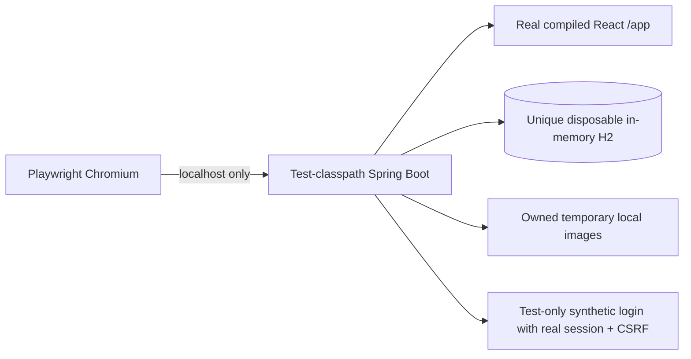

# QA2 — Playwright end-to-end browser tests

## Architecture and safety boundary

Official Playwright Test with TypeScript drives Chromium against an owned, loopback-only Spring Boot process. It tests the real compiled React application under `/app`, as deployed, with same-origin REST, session cookies, CSRF and WebSockets. The existing Vite development layout remains unchanged. There are no production-code authentication changes.



`playwright.config.ts` fixes the target to `http://localhost:18089`; `SPOTPULSE_E2E_PORT` can select another unprivileged local port. It deliberately has no external base-URL environment option. `reuseExistingServer=false` and the supervisor's bind probe reject port collisions instead of reusing the developer's application. Health readiness is checked using `/health`, with a bounded startup timeout, not a fixed startup sleep. Browser routing blocks requests outside this origin, including Google, Cloudinary and map services.

`tools/run_e2e.py` launches the actual Java 25 executable rather than a Windows launcher shim. It removes inherited Spring, SpotPulse, Google, Cloudinary, Telegram, Vite and JDBC environment settings and Java-option injections. `E2eApplication` accepts only an owned OS-temporary directory and a port; its datasource is internally generated as `jdbc:h2:mem:e2e-<UUID>`. There is no production URL, JDBC URL or developer database argument. It binds `127.0.0.1`, forces profile `e2e`, local storage and Telegram disabled, and uses synthetic OAuth settings. Cloudinary is never selected.

The existing test-classpath database guard remains active. Image storage is explicitly fixed to the verified runtime's temporary `images` directory. Multipart files also use the owned directory. Database data disappear with the JVM. Normal completion and test failures invoke global teardown, which signals the supervising Python process, waits for JVM termination and bounded directory cleanup, then allows Playwright to stop its server. This also avoids Windows force-kill bypassing Python cleanup. A hard OS kill, power loss or forced terminal termination can leave a `spotpulse-e2e-*` temporary directory; no persistent application database is used. Do not delete arbitrary temporary paths to clean up.

The deployed `https://spotpulse.onrender.com` is not contacted by this suite. Existing local H2 and Render PostgreSQL records remain outside its scope.

## Test-only authentication

`src/test/java/com/spotpulse/e2e/E2eApplication.java` contains the bootstrap, explicit `@TestConfiguration` and fixture controller. None is in `src/main` or the production JAR/Docker image. Both harness and controller require profile expression `e2e & !prod & !local`; production and ordinary local profile tests prove the seam is absent. Starting the normal production artifact cannot enable it because the classes are not packaged.

Only this explicit bootstrap adds the `/__e2e/**` security chain. Its reset/login POSTs still require a real session CSRF token obtained from `/api/auth/csrf`. Login accepts one of four fixed synthetic actors, rotates the session ID and saves an `OAuth2AuthenticationToken` with the same `AppOidcUser` principal used by the application. Subsequent application requests go through the unchanged security chain, database role refresh, ownership checks and CSRF. There are no browser-supplied roles or user IDs. Logout uses the real application endpoint and invalidates the session.

This simulates an already verified Google identity; it does **not** test Google credentials, consent, authorization-code exchange or Google's identity verification. A separate test verifies the real OAuth filter initiates a Google redirect with state and the configured callback, without following the redirect or contacting Google.

## Fixtures and scenarios

`e2e/fixtures.ts` automatically resets only the isolated database before every test. A fresh browser context provides independent sessions. One worker and zero automatic retries make shared fixture/flag changes deterministic and expose failures. Eight spaces include separate owners, eight rooms, a premium entitlement, enabled feature flags, and a confirmed booking seven days ahead. The first room is initially available; the second has the known occupied interval. IDs are returned from setup rather than assumed to reset to one. Fixtures use reserved `.example.test` identities and contain no real customer information.

The suite contains **13 browser scenarios**:

1. Public landing/catalog, search, city filtering, pagination, room details, direct navigation and reload.
2. Anonymous protected UI/API rejection, missing resource and client/server unknown-route behavior.
3. Google OAuth redirect initiation without external login.
4. USER profile, absent management navigation, OWNER/ADMIN denial, premium mutation denial, missing-CSRF rejection and logout.
5. OWNER space creation/edit, native required-field/range validation, room creation/edit and reload persistence.
6. Cross-owner space/room denial and ADMIN management access/edit.
7. UI booking creation, navigation/reload persistence, overlapping booking feedback and UI cancellation.
8. Real browser WebSocket receives committed booking/cancellation notifications and refreshes REST availability.
9. HTTP polling detects the same changes; both transport tests switch modes.
10. Premium badge appears for entitlement/enabled flags and disappears after an ADMIN disables the master flag through the UI.
11. Known occupied interval and invalid booking interval feedback.
12. Browser image preview/metadata, clearing/replacing selection, simulated upload failure with retained selection, retry, isolated local upload, cross-owner upload denial and image delivery on details/catalog/reload.
13. Unsupported, empty and oversized browser image validation.

Most actions use accessible labels, roles and visible messages. API requests are limited to fixture setup, separate booking writers for subscriber tests, negative authorization/CSRF checks and independent state verification. WebSocket tests require actual `availability.changed` frames for both committed changes, the room ID, received-message counters and refreshed occupied intervals; polling waits on observable data. Neither asserts an unreliable millisecond threshold. There are no arbitrary browser sleeps.

## Local execution

Prerequisites: Java 25, Node 24, Python 3.12+, Maven wrapper dependencies and Chromium. Commands below run from `spotpulse-frontend`:

```powershell
npm ci
npx playwright install chromium
npm run e2e:typecheck
npm run e2e:prepare
npm run e2e
npm run e2e -- --grep "book, persist"
npm run e2e:headed
npm run e2e:ui
npm run e2e:report
```

`e2e:prepare` sanitizes inherited settings, fixes browser API/auth paths to the local same origin, builds the deployment SPA and runs Maven `-Pspa test-compile dependency:build-classpath`. Runtime classpath puts `target/classes` before test resources, so the real built SPA is served instead of the small unit-test index. It does not start the ordinary persistent local application. Prepare again after changing backend/SPA code. Run preparation, browser tests and Maven regression builds sequentially; do not recompile or clean the shared target directory during an active test run.

For a local port collision, set `$env:SPOTPULSE_E2E_PORT='18090'` before execution; only localhost is supported. On Linux install browser dependencies using `npx playwright install --with-deps chromium`. Global teardown is also used by the headed/UI workflow; stop through Playwright rather than force-killing terminals.

HTML reports are under ignored `playwright-report/`; failure screenshots and retained traces are under ignored `test-results/`. View with `npm run e2e:report` and open the failed test, or `npx playwright show-trace test-results/<test>/trace.zip`. Traces may include synthetic session cookies/CSRF tokens: keep them local, do not commit or publish them. No storage-state file is generated. See official [web-server lifecycle documentation](https://playwright.dev/docs/test-webserver) and [Trace Viewer documentation](https://playwright.dev/docs/trace-viewer).

## GitHub Actions and deployment gating

The added check is **Playwright E2E (Chromium)**. It sets up Java 25, Node 24 and Python 3.12, runs `npm ci`, installs Chromium and Linux dependencies, checks E2E TypeScript, prepares the isolated application and executes all browser tests headlessly. No account secrets are configured or needed. On failure only matching PNG screenshots are uploaded for seven days; cookie-bearing traces, HTML reports, backend logs, storage states and environment dumps are excluded.

All existing backend, frontend and utilities checks remain. **Production Docker image** now also requires the E2E job, so a failed browser suite prevents that downstream check from passing. Manually add **Playwright E2E (Chromium)** to GitHub branch protection alongside **Backend tests (Java 25)**, **React tests and production build**, **F2 JavaScript and C8 geocoding**, and **Production Docker image**. Keep Render's native **After CI Checks Pass** setting. No new deployment mechanism, hook, push or deployment is introduced. A passing browser run does not guarantee Render startup or successful external-provider configuration.

## Actual execution results

Local environment: Windows, Java 25, Node 24.21.0, Python 3.12.0, Playwright Test 1.64.1 and bundled Chromium 156.0.8078.4. No public Render or provider verification was performed.

| Check | Actual result |
| --- | --- |
| Playwright Chromium, complete suite | Final strengthened run: 13/13 passed, zero failures/skips/retries, 1.6 minutes; earlier complete rerun also passed 13/13 in 2.3 minutes |
| Full backend `mvnw -B -ntp -Pspa verify` | 246/246 passed, zero failures/errors/skips, Maven 4:26 minutes; includes 3 new seam/isolation tests |
| Full React `npm test` | 97/97 passed in 11 files, 116.20 seconds |
| Application TypeScript + production Vite build | Passed; 63 modules, Vite 8.03 seconds |
| Sanitized `npm run e2e:prepare` | Passed; Vite 11.44 seconds, Maven 13.952 seconds |
| E2E TypeScript | Passed using `npm run e2e:typecheck` |
| F2 autocomplete | 8/8 passed, 357.2615 ms |
| C8 offline geocoding | 5/5 passed, 1.473 seconds |
| Workflow validation | Actionlint 1.7.12 passed; optional shellcheck/pyflakes unavailable and disabled |
| Python helpers / whitespace | `py_compile` and `git diff --check` passed |
| Production packaging boundary | Inspected rebuilt JAR: real compiled SPA present, no `com/spotpulse/e2e` classes and no test index |
| Runtime cleanup | Final suite exited 0 after supervisor/JVM shutdown and temporary storage cleanup; no active-runtime marker remained |

The initial browser run passed one scenario and exposed a repeat-reset unique-email failure in 12 subsequent scenarios. Immediate bulk deletion corrected the test fixture's Hibernate insert-before-delete ordering; the complete rerun passed. An initial backend run reported one `NoClassDefFoundError` because a concurrent Maven recompilation removed probe classes while tests were running. Build/test operations were then serialized and the full suite passed, including the three-process persistence probe. No failing test was disabled or given automatic retries. These intermediate failures remain recorded in ignored `target/qa2` logs.

The configured GitHub Actions workflow has been validated locally but not executed on GitHub in this task. No commit, push or deployment was performed. Backend results and browser results apply to isolated local fixtures, not production Google/Cloudinary/Render behavior. QA2 is ready for review, commit and the first hosted CI run; update required branch checks manually after pushing.

## Instructor demonstration

1. Show the test-only Java source location and production packaging boundary, the localhost-only Playwright target and disposable database guard.
2. Run preparation and `npm run e2e:headed -- --grep "book, persist"` to show booking, conflict and cancellation in the real UI.
3. Run the WebSocket scenario to show a real notification-triggered availability refresh, then the polling scenario for the same data flow.
4. Run the local image scenario to demonstrate native file preview, failed-upload retry and persisted public image delivery without cloud credentials.
5. Run the complete suite headlessly, open the HTML report and show the scenario results. For a genuine failure, inspect its local screenshot/trace; do not deliberately alter production or hide a failure with retries.
6. Show the CI workflow and five required checks. A real GitHub execution must occur after the owner reviews and pushes the change.

## Limitations

Chromium only; Firefox/WebKit, mobile layouts and visual pixel comparisons are outside this assignment. Headless execution was performed; optional headed/UI commands are provided but were not exercised interactively. Synthetic identities exercise application sessions/authorization, not a real Google account. Cloudinary delivery, Telegram delivery, Render TLS/proxy/cold starts and real PostgreSQL are deliberately not exercised. Booking data use the application's stored calendar-time conventions and a future interval derived from the backend date. Browser transports are tested with observable bounded waits, not used as performance measurements. Test reset is serialized; parallel workers/shards would need separate backend instances/databases. CI failure screenshots contain only synthetic fixtures, but still review artifacts before sharing.
